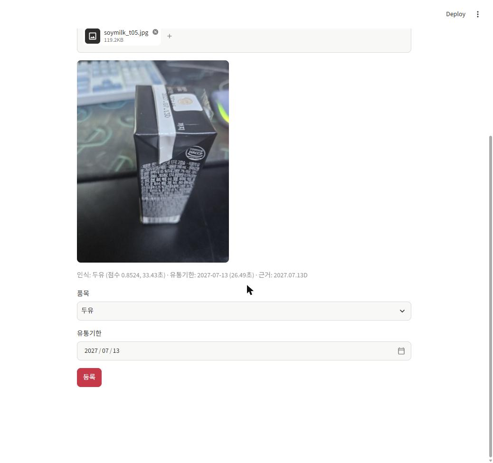
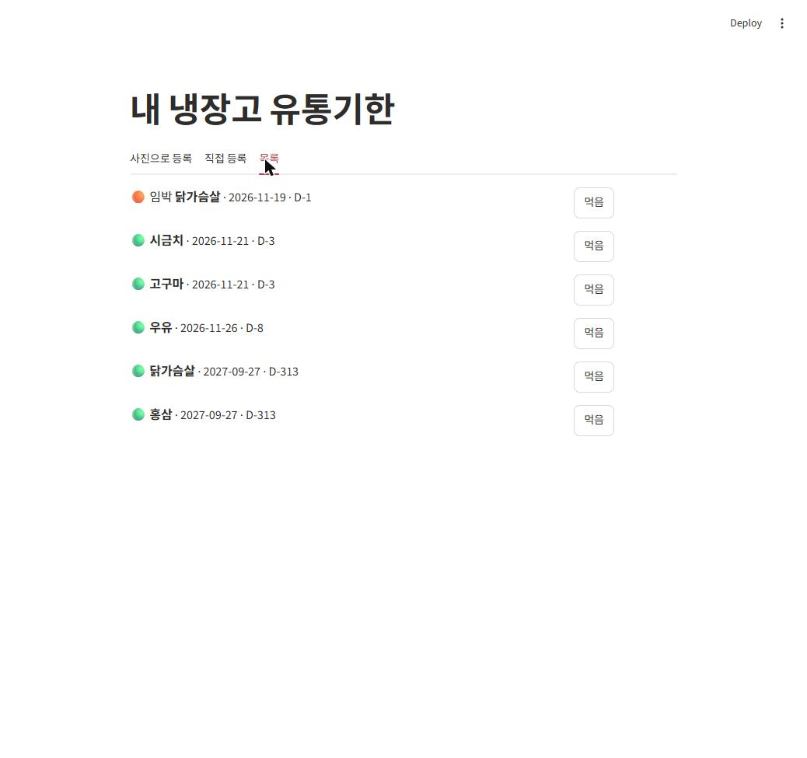

# fridge-keeper: 사진 한 장으로 냉장고 음식과 유통기한 등록하기

> 아이펠 AI에이전트 3기 · 03 모듈 Main Quest 2 (내 도메인에서 AI로 개선 지점 찾아서 PoC 만들기)

- 문제 정의서: [`문제정의서.md`](문제정의서.md)
- 흐름: **사진 → 품목 인식(기준 사진 벡터 검색, SigLIP 2) → 유통기한 읽기(PaddleOCR + 날짜 규칙) → 확인·수정 → 등록 → D-day 목록**

## 바로 써 보기 (브라우저판, 설치 없음)

**https://gkerala.github.io/4-main-quest-fridge-keeper/**

- 모델이 방문자의 브라우저 안에서 돈다. 사진은 밖으로 나가지 않고, 목록은 그 브라우저(localStorage)에만 남는다. 처음 한 번 모델(약 110MB)을 내려받는다.
- 사진이 없으면 화면의 시험 사진 3장(두유·우유·고구마)을 눌러 볼 수 있다.
- 원본 PoC와 다른 점: 품목 인식은 같은 SigLIP 2를 8비트로 줄인 것, 유통기한은 PaddleOCR **PP-OCRv4 모바일**(원본은 PP-OCRv5 server + v6 읽기). 날짜 규칙은 `expiry.py`를 그대로 옮겼다(`node expiry_check.mjs`로 확인). 가벼운 모델이라 **정확도는 다시 재지 않았다.** 이 PC(Chrome)에서 시험 사진 3장: 두유 품목·날짜(2027-07-13) 맞음, 고구마 품목 맞음 + 기본 3일, 우유 품목 맞음(날짜가 안 보이는 사진이라 직접 입력). 날짜 읽기 약 10초.
- 파일: `docs/`(페이지), `web_build.py`(기준 사진 축소본·시험 사진 만들기), `docs/vendor/paddleocr.bundle.js`(`@gutenye/ocr-browser` 1.4.9를 esbuild로 묶은 것).

## 실행 방법 (Windows, CPU)

```powershell
uv venv --python 3.12 .venv
uv pip install --python .venv\Scripts\python.exe torch==2.15.0 torchvision==0.29.2 --index-url https://download.pytorch.org/whl/cpu
uv pip install --python .venv\Scripts\python.exe -r requirements.txt
.venv\Scripts\streamlit run app.py          # 앱
.venv\Scripts\python evaluate.py            # 검증 (처음 사진 data/photos + 시험 사진 data/test)
python expiry.py                            # 날짜 규칙 단독 시험
```

처음 실행할 때 모델을 내려받는다: `models/yolo26n.pt`, `models/yolov8s-worldv2.pt`(ultralytics), `google/siglip2-base-patch16-224`(Hugging Face), PaddleOCR 모델(PP-OCRv5 server/mobile 글자 위치, PP-OCRv6 medium·한국어 v5 mobile 글자 읽기).

## 파일

| 파일 | 역할 |
|---|---|
| `fridge.py` | 품목 인식 6가지 방법 + 유통기한 읽기 9가지 방식 |
| `expiry.py` | OCR 글자 줄에서 소비기한 날짜를 고르는 규칙 (제조일자는 제외) |
| `app.py` | Streamlit 앱: 사진 등록 / 직접 등록 / 목록. 등록 시간과 수정 여부를 `logs/timing.csv`에 남김 |
| `evaluate.py` | 정답 파일(`data/labels.csv`, `data/test/labels.csv`)과 비교해 `results/`에 표 저장, 가장 좋은 방법을 `results/best_method.txt`에 기록 |
| `data/` | 처음 사진 19장(기준), 시험 사진 105장, 추가 기준 사진(`refs/`). 출처는 각 폴더 `SOURCES.md` |
| `items.json` | 관리 품목 목록 |

## 모델 선정 (비교 후보)

| 방법 | 무엇 | 왜 후보인가 |
|---|---|---|
| `yolo` | YOLO26n 기본(COCO 80종) | 기준선. 우유팩·시금치·닭가슴살이 COCO에 없다 |
| `world` | YOLO-World v2 | 품목 이름을 글로 주면 찾는다 |
| `siglip` | SigLIP 2 | 사진과 한국어 설명의 일치 점수 |
| `world+siglip` | 위치는 YOLO-World, 이름은 SigLIP 2 | 두 모델의 장점 결합 |
| `ref` | 기준 사진을 SigLIP 2 벡터로 저장, 새 사진과 가장 가까운 품목 | 같은 제품을 다시 찍는 상황(내 냉장고)에 맞음 |
| `world+ref` | YOLO-World로 잘라 낸 영역을 기준 벡터와 비교 | 배경 영향 줄이기 |

## 검증 결과

### 품목 인식 (목표 80% 이상)

정답은 사진을 돌리기 전에 적었다. 판정은 **시험 사진 105장**(처음 사진과 다른 각도·거리로 다시 찍은 사진 102장 + 위키미디어 시금치 3장)으로 하고, 기준 사진 방식의 기준은 처음 사진 19장 + `data/refs/` 목살 2장이다.

| 방법 | 시험 사진 105장 | 같은 날 사진 19장(자기 제외, 낙관적) | 사진 1장당 |
|---|---|---|---|
| `yolo` | 1% | 5% | 0.03초 |
| `world` | 11% | 26% | 0.07초 |
| `siglip` | 69% | 95% | 0.30초 |
| `world+siglip` | 70% | 95% | 0.38초 |
| **`ref`** | **83% (87/105)** ✅ | 95% | 0.12초 |
| `world+ref` | 81% | 95% | 0.19초 |

**고른 방법: `ref`** (앱 기본값). 품목별(시험 사진, `ref`): 우유 18/20 · 두유 16/16 · 시금치 3/3 · 고구마 17/17 · 목살 16/17 · **닭가슴살 10/17 · 홍삼 7/15**.

- 정정: 시험 사진을 나눌 때 우유 사진 1장을 닭가슴살(`chicken_t01`)로 잘못 넣었다. 유통기한 정답을 달다가 발견해 `milk_t20`으로 고쳤다(`ref`는 원래 우유로 맞게 봤다). 82% → 83%.

- 같은 날 사진(95%)과 시험 사진(69~83%)의 차이가 크다. 같은 날 찍은 사진끼리 비교하면 답을 거의 보고 푸는 셈이라, 판정은 시험 사진으로만 했다.
- COCO 기본 YOLO는 우유·두유·닭가슴살·홍삼이 클래스에 없어서 사실상 못 쓴다. YOLO-World도 "soy milk carton" 같은 이름으로는 잘 못 찾았다.
- 글 설명으로 맞히는 SigLIP 2는 처음 보는 제품에도 쓸 수 있지만, 홍삼 앰플 상자(1/15)를 설명으로 구분하지 못했다. 내가 찍은 사진을 기준으로 삼는 `ref`가 이 경우 훨씬 낫다.
- 추가로 시도한 점수 방식(같은 시험 사진): 품목별 평균 벡터 80/105, 가장 가까운 사진 + 글 점수 섞기 87~88/105. 1~2장 차이는 시험 사진에 맞춰 고른 결과일 수 있어 채택하지 않았다.

### 실패 사례 (품목 인식, `ref`)

| 틀린 방향 | 장수 | 원인 추정 |
|---|---|---|
| 홍삼 → 두유 | 8 | 둘 다 네모난 종이 상자. 홍삼 기준 사진이 4장뿐이고 각도가 비슷하다 |
| 닭가슴살 → 시금치 / 두유 | 4 / 3 | 비닐 포장이 빛을 반사하고 뒷면 사진은 흔들렸다. 기준 사진 4장 |
| 우유 → 두유 | 2 | 위·바닥만 찍힌 사진 |
| 목살 → 시금치 | 1 | 붉은 고기 일부만 보이는 사진 |

다음 단계: 앱에서 사용자가 확인한 사진을 기준 사진에 더하면 약한 품목(홍삼·닭가슴살)의 기준이 늘어난다.

### 유통기한 읽기 (목표: 날짜가 보이는 사진 80% 이상, 지어낸 날짜 0)

두 묶음으로 쟀다.
- **처음 사진 19장** (날짜 보이는 9장): 날짜 규칙을 이 사진들을 보며 고쳤으므로 **낙관적인 참고값**.
- **시험 사진 105장** (날짜 보이는 8장, 판정용): 모델을 돌리기 전에 사람이 눈으로 날짜를 적었다(`data/test/expiry_by_eye.csv`). 우유·닭가슴살 시험 사진은 흔들리거나 날짜 없는 면이라 날짜가 보이는 사진이 없었다. 나머지 97장은 '날짜를 지어내는가' 검사에 쓴다.

| 방식 | 글자 위치 / 글자 읽기 모델 | 처음 9장 | **시험 8장** | 지어낸 날짜 (시험 105장) | 1장당 (시험) |
|---|---|---|---|---|---|
| `base` | server_det / 한국어 v5 mobile, 처음 규칙 | 2/9 | - | ("9.7 kcal" → 9월 7일 오답) | - |
| `strict` | 같은 모델, 규칙 개선 | 2/9 | 2/8 | 0 | 18초 |
| `orient` | strict + 글자 줄 방향 판별 | 1/9 | - | - | - |
| `rotate` | strict + 180°·90°·270° 돌려 다시 읽기 | 4/9 | - | - | - |
| `mdet+rotate` | **mobile_det** / 한국어 v5 | 7/9 | 0/8 | - | - |
| `fast+rotate` | **mobile_det** / **PP-OCRv6** | 8/9 | 5/8 | 0 | 4초 |
| **`v6+rotate`** | server_det / **PP-OCRv6** | 5/9 | **7/8 (88%)** ✅ | **0** | 42초 |

**고른 방식: `v6+rotate`** (시험 사진에서 가장 높음, 앱 기본값). `-`는 재지 않은 칸(`rotate` 계열은 시험 105장에 2시간 넘게 걸려 처음 사진 결과로 걸렀다).

- **정정:** 처음엔 "가벼운 글자 위치 모델(mobile_det)로 바꿨더니 좋아졌다"고 적었는데 틀렸다. 모델 이름을 직접 주면 PaddleOCR이 `lang="korean"`을 무시하고 글자 읽기 모델까지 PP-OCRv6로 바꾼다(실행 기록의 `Creating model`로 확인). 두 모델을 나눠 쟀더니 효과는 **글자 읽기 모델(PP-OCRv6)** 쪽이었다. 지금은 `fridge._ocr`가 두 모델을 항상 이름으로 정한다.
- 처음 사진과 시험 사진에서 1등이 다르다(`fast+rotate` 8/9 vs `v6+rotate` 7/8). 규칙을 고칠 때 본 사진의 점수는 믿지 않기로 하고 시험 사진으로 골랐다. 대신 날짜가 보이는 시험 사진이 8장뿐이라 1장이 12%p다.
- 대가는 속도: 사진 1장에 평균 42초(날짜가 바로 보이면 12~25초, 없으면 네 방향을 다 돌아 길다). `fast+rotate`는 4초.
- 우유는 기한(11.26)과 제조(11.14) 두 줄이 나란히 찍혀 있다. OCR 확신도를 점수에 섞었더니 제조일이 뽑혀서, 확신도는 0.5 미만 버리기에만 쓰고 문맥이 같으면 늦은 날짜를 고르게 바꿨다.
- 정답 파일 정정: `milk_02`에 날짜가 찍혀 있는 것을 처음에 놓쳤다. 모델이 읽어 낸 뒤 사진을 다시 보고 고쳤다.
- 남은 실패(시험): 거꾸로 찍힌 두유 `soymilk_t01`.

## 한계

- **유통기한 판정 표본이 작다.** 날짜가 보이는 시험 사진은 8장(두유 6, 홍삼 2)뿐이고 우유·닭가슴살은 0장이다. 우유·닭가슴살 날짜는 처음 사진으로만 확인했다.
- 시험 사진도 같은 날, 같은 제품이다. 다른 회사 우유나 새로 산 홍삼은 기준 사진이 없어서 `ref`가 맞힌다는 보장이 없다 → 처음 보는 제품은 글 설명(`siglip`)이나 수동 입력으로 넘겨야 한다.
- 시금치 시험 사진 3장은 내 사진이 아니라 위키미디어 사진이다.
- 사진 한 장 = 품목 한 개를 전제한다(가장 큰 박스 하나).
- 사진은 긴 변 2000px로 줄여서 쓴다(`fridge.MAX_SIDE`). 폰 원본(4000×3000)을 그대로 넣었을 때 메모리가 64GB까지 올라 PC가 멈출 뻔했다. 줄인 뒤 같은 사진의 최대 메모리는 4.2GB. 대신 멀리서 찍어 아주 작은 날짜는 뭉개질 수 있다.
- CPU에서 유통기한 읽기는 사진 한 장에 평균 42초, 길면 70초. 직접 등록이 약 10초(사용자 실측)라 등록 시간 목표(8초 이하)에 못 미친다 → 앱에서 '정확하게(v6+rotate) / 빠르게(fast+rotate, 4초)'를 고를 수 있게 했다.

## 시연 화면

| 사진으로 등록 (시험 사진 `data/test/soymilk_t05.jpg`) | 목록 (남은 일수 순) |
|---|---|
|  |  |

사진을 올리면 품목(두유, 점수 0.85)과 유통기한(2027-07-13, 근거 글자 `2027.07.13D`)이 채워지고, 사용자가 확인한 뒤 등록한다. 목록은 남은 일수가 적은 순이고 임박한 것은 주황색으로 표시한다. (첫 실행은 모델을 불러오느라 수십 초가 걸린다.)

## 시연 결과 (실제 사용, 2026-11-17~18)

폰으로 새로 찍은 사진을 PC 앱(localhost)에 올리고 확인 후 등록했다. 시간은 사진을 올린 순간부터 등록 버튼까지(사람이 확인하는 시간 포함), `logs/timing.csv`.
첫 줄(모델을 처음 불러온 우유 119.5초)과 직접 등록 탭의 잘못 잰 2줄(729.9초, 567.8초: 페이지를 연 순간부터 잼)은 뺐다.

| 사진 | 방식 | 품목 | 날짜 | 시간 | 결과를 고치지 않고 등록 |
|---|---|---|---|---|---|
| 닭가슴살 뒷면 | 정확하게 | ✅ | ✅ 2027-09-27 | 48.4초 | ⭕ |
| 목살 | 빠르게 | ✅ | 기본 90일 | 20.6초 | ⭕ |
| 닭가슴살 앞면 | 빠르게 | ✅ | 못 읽음(날짜 없음) → 직접 입력 | 21.9초 | ✕ (날짜 입력) |
| 닭가슴살 뒷면 | 빠르게 | **❌ 홍삼** | ✅ 2027-09-27 | 13.4초 | ✕ (품목이 틀림) |
| 시금치 | 빠르게 | ✅ | 기본 3일 | 12.1초 | ⭕ |
| 우유 | 빠르게 | ✅ | ✅ 2026-11-26 | 5.9초 | ⭕ |
| 고구마 | 빠르게 | ✅ | 기본 3일 | 14.3초 | ⭕ |

- **고치지 않고 등록: 5/7 (71%)**, 목표 80% 미달.
- **등록 시간: '빠르게' 평균 14.7초**(6건), 8초 안에 든 것은 우유 1건. 직접 기록(약 10초)보다 느리다 → **목표 미달**.
- 닭가슴살 **뒷면(분홍 성분표)**이 홍삼으로 인식됐다(점수 0.82). 기준 사진에 닭가슴살 뒷면이 적어서, 같은 물건이라도 다른 면은 못 알아본다. 속도를 재느라 확인 없이 바로 등록을 눌러서 기록상 `name_fixed=0`이지만 틀린 결과로 센다. 등록 직후 틀린 것을 보고 닭가슴살로 다시 등록했다.
- 앱의 직접 등록 탭 기록(약 5초, 2건)은 품목과 날짜를 이미 알고 연달아 고른 값이라 비교 기준으로 쓰지 않았다. 비교 기준은 앱 없이 손으로 기록할 때의 약 10초(사용자 실측).

## 다음 단계 (이번 PoC 범위 밖)

1. 앱에서 확인·수정한 사진을 기준 사진에 더하기 (약한 품목: 홍삼 7/15, 닭가슴살 10/17, **닭가슴살 뒷면**)
2. 우유·닭가슴살 날짜가 선명한 사진을 더 찍어 유통기한 판정 표본 늘리기
3. 등록 시간 줄이기: 품목 인식(0.3초)을 먼저 보여 주고 날짜는 뒤에서 읽기, 날짜가 없는 품목(시금치·고구마·목살)은 날짜 읽기를 건너뛰기. 직접 등록 탭의 시간은 페이지를 연 순간이 아니라 첫 입력부터 재도록 고치기
4. **폰에서 분석하기**: 서버는 품목·날짜만 저장하고, 모델은 폰 브라우저에서 돌린다(transformers.js, onnxruntime-web). 사진이 폰 밖으로 안 나가고 서버 비용이 거의 없다. 대신 가벼운 모델로 바뀌므로 정확도를 다시 재야 한다.
5. 비교 후보 더하기: 이미지를 이해하는 대형 언어 모델(사진 한 장으로 품목·날짜를 한 번에), 날짜 부분을 먼저 찾고 읽는 2단계 모델(ExpDate)
6. 큰 원본에서 작은 글자 지키기: 줄인 사진에서 글자 위치만 찾고, 그 부분은 원본에서 잘라 읽기

## 기존 서비스 조사 (2026-11-17)

비슷한 것이 이미 있다. 이 PoC는 '내가 먹는 몇 개 품목 + 내 사진을 기준으로 + 날짜를 지어내지 않게 + 정확도를 숫자로'에 집중했다.

| 종류 | 예 | 방식 |
|---|---|---|
| 한국 앱 | [냉털이](https://apps.apple.com/kr/app/id6746837808), [아마따](https://apps.apple.com/kr/app/id6677048352) | 사진으로 식재료 인식(라벨 날짜 읽기는 설명에 없음) / 바코드 |
| 해외 앱 | [FridgeUp](https://www.producthunt.com/p/fridgeup/fridgeup-2), [Food Expiry AI](https://apps.apple.com/app/id6789433988), [FreshSave](https://apps.apple.com/app/id6762173662) | 날짜 OCR + 사용자 수정, 기기 안 OCR |
| 오픈소스 | [api-ocr-expiration-date](https://github.com/jvclisboa/api-ocr-expiration-date), [ShelfSense](https://github.com/Wrathemperor/-Smart-Expiry-Scanner-App) | PaddleOCR(이 PoC와 같음) / Gemini Vision으로 품목·날짜 동시 추출 |
| 연구 | [ExpDate (Seker & Ahn, 2022)](https://felizang.github.io/expdate) | 날짜 영역 탐지 → 인식, 실제 사진 1,767장 데이터셋 |

## 이 PoC는 무엇을 했나

모델을 학습시키지 않았다. **완성된 모델(SigLIP 2, PaddleOCR, YOLO 계열)을 가져와 고르고, 조합하고, 같은 시험 사진으로 쟀다.** 8장 TabICL이 정답 달린 예시 행 몇 개를 보고 새 행을 맞히듯, `ref` 방식은 정답 달린 기준 사진 19장을 보고 새 사진의 품목을 맞힌다(다만 TabICL은 예시끼리의 관계를 따지도록 학습된 모델이고, `ref`는 가장 가까운 사진 하나를 고를 뿐이다).

## 회고

- **기대와 실제:** 예전에 냉장고 유통기한 기능을 수동으로 구현했다. 모델을 학습시키기에는 데이터가 부족했고 TabICL도 잘 몰랐기 때문이다. 이번에 TabICL을 배운 뒤 학습 없이 기존 모델을 가져다 쓰는 방식으로 진행했는데, 성공 기준에는 미치지 못했지만 생각보다 정확도가 높아서 놀랐다.
- **미달한 두 기준:** 높은 정확도는 무거운 모델을 썼을 때라 시간이 너무 오래 걸렸다. 그래서 가벼운 모델로 가볍게 쓰려고 한다. 가벼운 모델도 성공으로 잡은 시간을 넘겼지만, 내가 기준을 너무 타이트하게 잡은 건 아닌가 생각했다. 유사 앱들도 확인해 봤는데 내가 생각한 것처럼 완벽한 앱은 없었다. 바이브코딩으로 하루 만에 만들었다고 생각하면 나쁘지 않은 결과 같다.
- **닭가슴살 뒷면 → 홍삼:** 속도를 재려고 사진을 올리고 최대한 빠르게 등록 버튼을 눌렀는데, 누르고 나니 닭가슴살이 홍삼으로 적혀 있었다. 그래서 닭가슴살로 다시 등록했다.
- **다음에 하나만 고친다면:** 사용성 개선.
- **학습 없이 기존 모델 쓰기:** AI가 지금처럼 효율적이지 않던 때 다중 음식 분류 딥러닝 모델을 직접 학습시켜 테스트해 본 적이 있다. 그때와 비교하면 가져다 쓰는 쪽이 시간도 압도적으로 절약되고 정확도도 높은 것 같다. 모델 학습에서 가장 중요한 건 양질의 학습 데이터라고 생각하는데, 그 문제가 해결된 셈이다.
- **기존 서비스가 있는데 계속한 이유:** 이번 프로젝트가 기존보다 많이 개선된다면 내 개인 앱에 추가할 예정이기 때문이다.
- **03 모듈에서 가장 기억에 남는 프로젝트:** 당연히 이번 메인 퀘스트. 다만 남은 문제가 있다. 지금 성능이면 내 앱에서 수동으로 입력하는 것이 이 기능을 붙여 쓰는 것보다 더 빠르고 정확하지 않을까 하는 생각이 든다.

## 이 PC에서 겪은 설치 문제 (재현용 메모)

- PaddlePaddle은 Python 3.14 바퀴 파일이 없어 3.12로 만들었다.
- paddleocr가 opencv를 여러 개 설치하면 `cv2` import가 깨진다 → `opencv-contrib-python` 하나만 남긴다.
- Windows에서 paddle을 torch보다 먼저 불러오면 torch DLL 오류 → `fridge.py`가 torch를 먼저 불러온다.
- 한글이 든 경로의 Paddle 모델 파일을 못 읽는다 → 모델 캐시를 `%LOCALAPPDATA%\fridge-keeper`에 둔다.
- paddle 3.3 CPU의 oneDNN 경로 오류 → `enable_mkldnn=False`.
